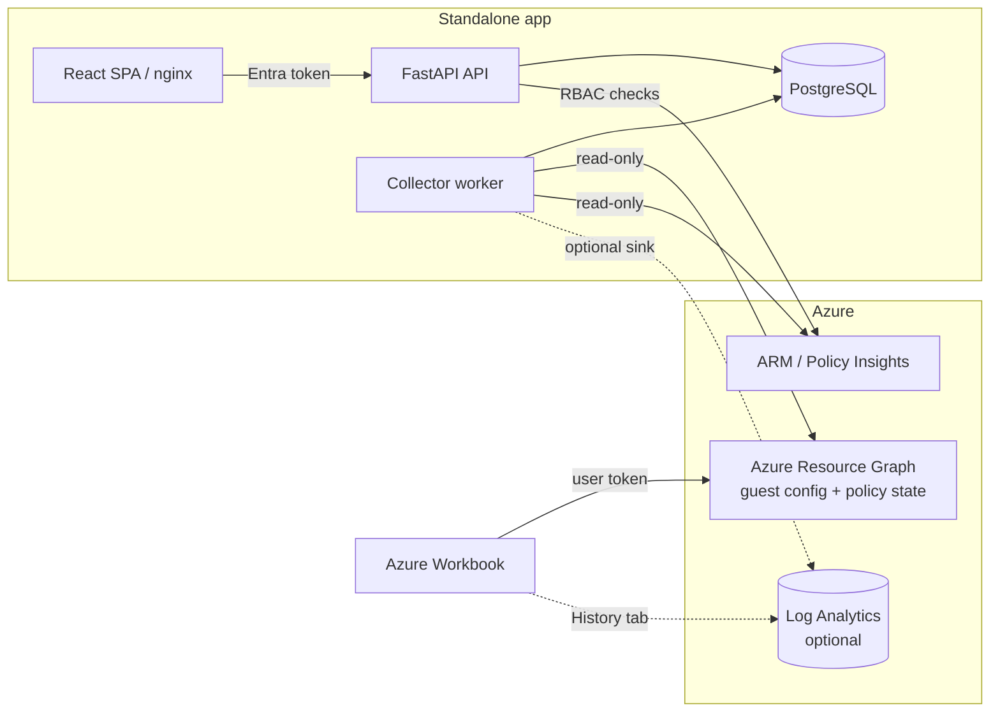

# Azure Compliancy Dashboard

Read-only reporting on Azure Policy and Azure Machine Configuration (Windows Azure Security Baseline and CIS Windows Server benchmark) for Azure VMs and Azure Arc-enabled servers.

## Overview

The dashboard answers "which Windows machines are compliant, how fresh is the evidence, and which individual checks fail" using only read access to Azure. Evidence quality (Fresh, Stale, UnknownAge, NoReport, ...) is reported separately from compliance state, and anything not provably fresh and compliant is never shown as green. See [docs/metrics-spec.md](docs/metrics-spec.md).

## Two surfaces

1. **Azure Workbook** (`workbooks/`, `infra/bicep/workbook/`): runs Azure Resource Graph queries in the user's own context, drilling down from estate to individual check. No backend, no stored data.
2. **Standalone web app** (`frontend/`, `backend/`): React/TypeScript SPA, FastAPI API, PostgreSQL, scheduled collection, history, and CSV/PDF export, with Entra ID sign-in and per-user Azure RBAC checks.

An optional Log Analytics "enhanced / history mode" ([docs/logs-reporting.md](docs/logs-reporting.md)) lets the app feed history into a workspace for the Workbook's History tab. Each surface works without the other.



## Status and honesty

Work in progress, **evidence-based**: nothing in this repository has been deployed to Azure, no app registrations have been created, no certification or compliance-attestation claim is made, and no license has been chosen yet. Many Azure API and Resource Graph assumptions are not verified against a live tenant. Read [docs/known-limitations.md](docs/known-limitations.md) and [docs/release-checklist.md](docs/release-checklist.md) before any customer use. Tenant and subscription IDs are configuration and are never hardcoded; no secrets belong in this repository.

## Quickstart

**App, Docker Compose** (images have not been built in CI; see known limitations):

```
copy .env.example .env      # placeholders only; set a local POSTGRES_PASSWORD
docker compose up --build
```

**App, mock mode** (no Azure, no backend needed; synthetic data only):

```
cd frontend
npm ci
$env:VITE_USE_MOCK_DATA = "true"; npm run dev
```

**Workbook**: preview and deploy with Bicep (`az deployment group what-if` first), or import `workbooks/azure-compliance.workbook.json` manually via the portal's Advanced Editor. Steps in [docs/workbook.md](docs/workbook.md).

## Documentation

Index: [docs/README.md](docs/README.md). Key pages: [release checklist](docs/release-checklist.md), [known limitations](docs/known-limitations.md), [operations](docs/operations.md), [auth and onboarding](docs/auth-and-onboarding.md).

## Local development

Prerequisites: Python 3.11, Node 24, Docker (optional).

**Everything via Docker Compose**

```
copy .env.example .env      # placeholders only; set a local POSTGRES_PASSWORD
docker compose up --build
```

Frontend: http://localhost:8080, API: http://localhost:8000 (`/healthz`, `/readyz`, `/api/v1/info`, docs at `/docs`). A one-shot `migrate` service applies Alembic migrations before the API and worker start. See [docs/operations.md](docs/operations.md) for hardening, backup/restore and deployment notes.

**Backend** (`backend/`)

```
cd backend
python -m venv .venv ; .venv\Scripts\activate
pip install -e ".[dev]"
ruff check . ; mypy . ; pytest
uvicorn app.main:app --reload
```

Configuration comes from `ACD_*` environment variables (see `.env.example`) and is validated at startup. Migrations: `alembic upgrade head` (or `alembic upgrade head --sql` to preview).

**Frontend** (`frontend/`)

```
cd frontend
npm ci
npm run lint ; npm run typecheck ; npm test ; npm run build
npm run dev
```

**Fixtures**: `pip install jsonschema` then `python scripts/validate_fixtures.py`.

**Workbook** (`workbooks/`): see `docs/workbook.md`. `python scripts/validate_workbook.py --bicep` and `pytest tests/workbook`.

**Enhanced / history mode (optional)**: Log Analytics tables, Bicep and the backend sink, see `docs/logs-reporting.md`. Workbook-only and app-only modes work without it.
